https://github.com/user-attachments/assets/cd06d5f8-49d8-4858-8489-06d2e0737e6c

<p align="center">
  
</p>

<p align="center">
  
  
  
  
  
  
</p>

**Two Make.com scenarios answer two different questions:**

| | Question | When it runs | Looks at | Output |
|---|---|---|---|---|
| ① | **Soll ich zu Aurora fliegen?** Is it worth booking a trip to Lapland? | daily, 21:00 | cloud forecast for 5 sites (2 days ahead) + Kp forecast + solar wind | Telegram alert with cloud cover per site and **Google Flights deep links** BER → KRN / LLA / IVL / KTT / RVN |
| ② | **Soll ich raus für Aurora?** Should I go outside right now? | every 30 min, 20:00–06:00 | real-time solar wind measured at L1 (≈ 1.5 million km upstream) | "Go outside" alert with 30–60 min lead time, plain-language explanation and camera settings |

No servers, no code to host: three public APIs, a handful of filters, and Telegram.

<p align="center"><a href="assets/aurora-walkthrough.mp4">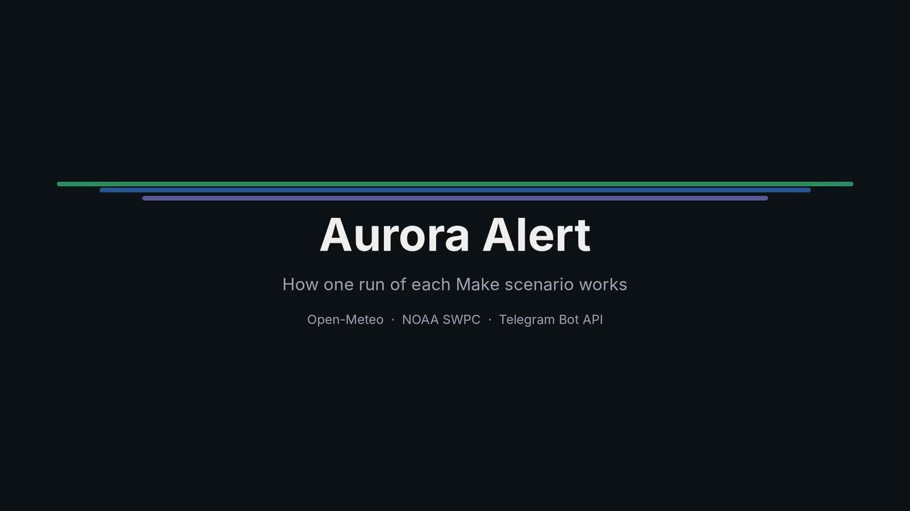</a><br><sub>▶ <a href="assets/aurora-walkthrough.mp4"><b>Watch the 64-second walkthrough</b></a>, filmed on the real Make.com scenarios: canvas, filters, a real alert run and a real quiet run.</sub></p>

---

## Architecture

<p align="center">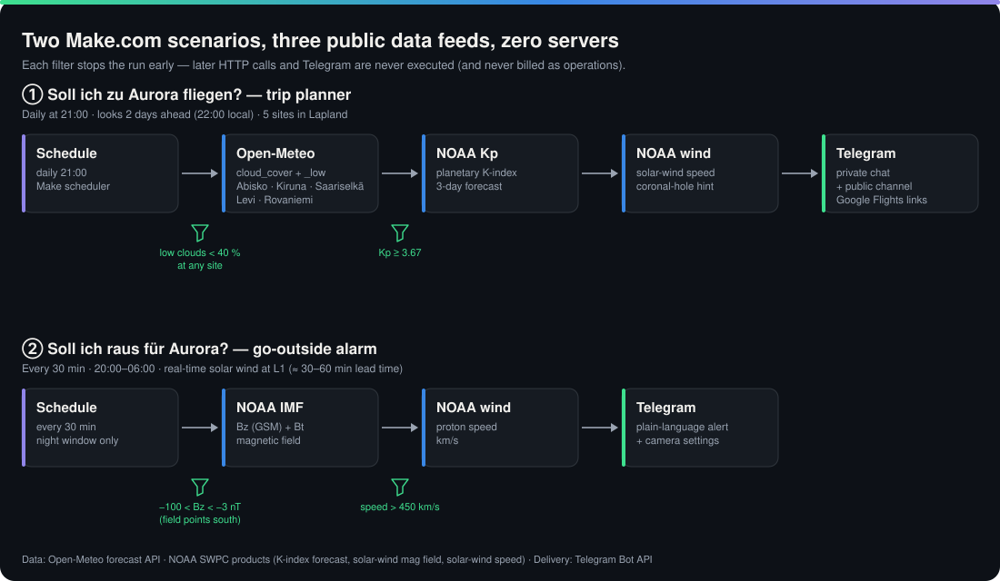</p>

<details>
<summary><b>Same flows as Mermaid (click to expand)</b></summary>


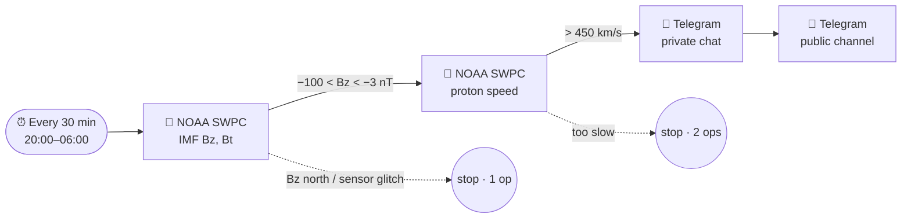
</details>

## Inside Make

| ① Trip planner: scenario canvas + 30-day ops chart | ② Live alarm: canvas + ops chart (peak during the 21–22 Oct storm) |
|---|---|
| 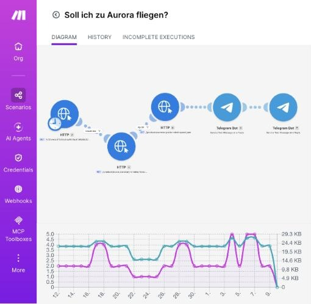 | 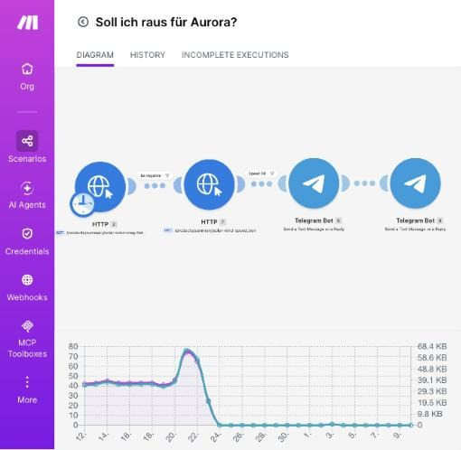 |
| 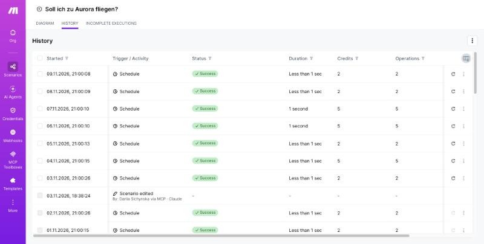 | 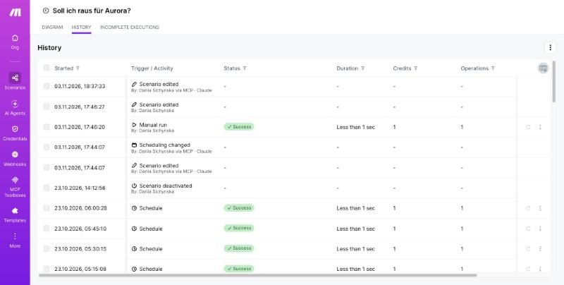 |

The operations column shows the filter design at work: **2 operations** on quiet nights, **5** when the alert goes out to both Telegram targets.

## What the alerts look like

<p align="center">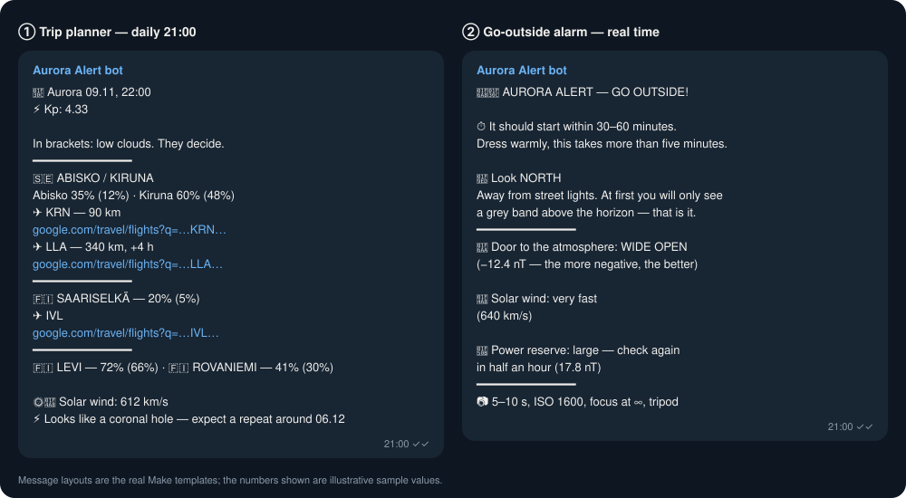</p>

---

## Live run statistics

Pulled from the Make execution log on **10 Nov 2026** (via the Make MCP API). Raw data lives in [`data/`](data/); every chart is rebuilt by [`scripts/make_charts.py`](scripts/make_charts.py).

### ① Trip planner: 32 evenings, 9 trip alerts

<p align="center">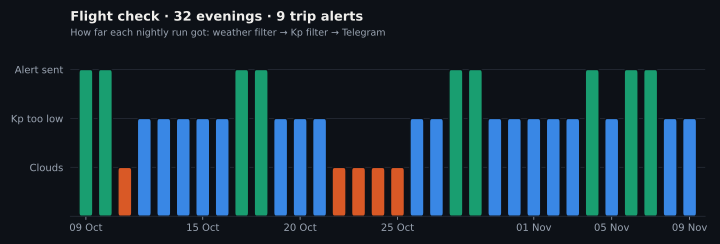</p>
<p align="center">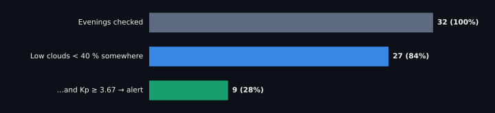</p>

| Metric | Value |
|---|---|
| Scheduled evening runs (9 Oct – 9 Nov) | **32**, all successful |
| Stopped by clouds at all 5 sites | 5 (16 %) |
| A clear site, but Kp forecast < 3.67 | 18 (56 %) |
| **Trip alert sent** | **9 (28 %)**, in clusters: 9–10, 17–18 and 28–29 Oct, then 4, 6 and 7 Nov |
| Operations used | 80, so **2.5 ops per evening ≈ 75 ops / month** |
| Median run time | 0.9 s (max 3.3 s) |
| Errors | 0 scheduled. 1 manual test run hit `503 Service Unavailable` from an API |

### ② Go-outside alarm: two storm nights at 15-minute resolution

<p align="center">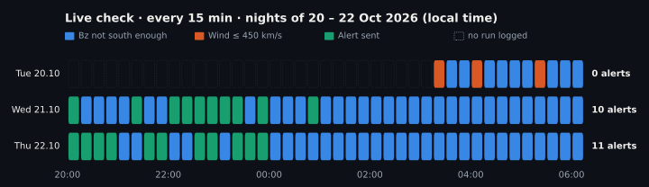</p>

On **21–22 October** the solar-wind conditions stayed "open" for hours, so the alarm fired **21 times in two evenings**. Each 15-minute run re-sent the same alert. This is the strongest argument for the cooldown in the [roadmap](#roadmap).

| Metric (94 runs, nights of 20 – 22 Oct) | Value |
|---|---|
| Bz not south enough | 70 |
| Bz south, but wind ≤ 450 km/s | 3 |
| **Alert sent** | **21** |
| Lifetime totals (Make counter) | 486 runs · 564 ops · 0 errors |

---

## The physics behind the filters

<details>
<summary><b>Why these three numbers? (click to expand)</b></summary>

**Kp index (trip planner).** Kp is a planetary 0–9 index of geomagnetic disturbance, built from 3-hour magnetometer readings worldwide. The higher it is, the further south the auroral oval spreads. NOAA SWPC publishes a 3-day forecast in 3-hour slots. The scenario reads the slot that matches the target night. Lapland (~68° N) sits under the oval even at low Kp, so **Kp ≥ 3.67 ("4−")** is a deliberately strict bar: it is only worth booking a flight for a *strong* show.

**Low clouds decide (trip planner).** Total cloud cover is misleading for aurora: thin high cirrus barely matters, while low stratus blocks everything. That is why the filter checks `cloud_cover_low` and the message shows total cover with low cover in brackets. The five sites act as an **OR**: one clear site is enough, because you can drive there.

**Bz and solar-wind speed (live alarm).** Spacecraft at the L1 point measure the solar wind about 1.5 million km before it reaches Earth. That gives **roughly 30–60 minutes of warning**.
- **Bz < 0** (southward interplanetary magnetic field) couples with Earth's field and "opens the door". The more negative, the better. The lower bound −100 nT rejects fill values and sensor glitches.
- **Speed > 450 km/s** means more energy is delivered. The message grades it as normal, fast (> 500) or very fast (> 600).
- **Bt** (total field strength) is shown as "power reserve": a high Bt means Bz can swing even more negative.

**27-day recurrence.** If the wind is faster than 580 km/s, the trip alert flags a likely **coronal hole**. Coronal holes rotate with the Sun (≈ 27 days), so the alert predicts a repeat date with `addDays(now; 27)`.
</details>

## Engineering notes

- **Filter-first ordering = cost control.** In Make, every executed module costs an operation. Putting the cheapest, most-often-failing check first (clouds, or Bz) means **72 % of trip-planner evenings stop after 1–2 operations**. Telegram only runs on the 28 % of evenings that matter.
- **OR filter across sites.** The "Clouds low" filter has five OR-groups, one per site. Any single clear site passes.
- **Index arithmetic.** Open-Meteo returns 72 hourly values (3 days × 24 h, local time zone). Make arrays are **1-based**, so `hourly.cloud_cover_low[71]` is 22:00 local on day 3. That matches the "+2 days, 22:00" in the message.
- **Defensive parsing.** NOAA values can arrive as strings, so every comparison goes through `parseNumber()`.
- **Kp slot without a date lookup.** The NOAA forecast file holds 81 three-hour slots: 7 days back, 3 days ahead, starting at 00:00 UTC. At run time (20:00 UTC) slot `data[80]` is **21:00 UTC two days ahead = 22:00 CET**, the same night the cloud check targets (verified against the live file on 10 Nov 2026).
- **Inline decision logic.** The plain-language grades ("doors wide open", "very fast wind", "big power reserve") are nested `if()` expressions inside the Telegram template. No extra modules, no extra operations.
- **Deep links instead of a flight API.** Google Flights `?q=` URLs with computed dates (`addDays(now; 2)` to `addDays(now; 5)`) open a ready-made search for each airport. That costs nothing and needs no API key.
- **Free-tier budget.** The trip planner uses ~75 ops/month. The live alarm uses at least 1 op per run: 21 runs/night × 30 ≈ **630+ ops/month** at a 30-minute interval (twice that at 15 min). On 3 Nov the interval went from 15 to 30 min, which halves that.

## Roadmap

- [ ] **Cooldown / de-duplication** for the live alarm. Store the last alert time in a Make **Data Store** and skip new alerts for 90 min (the 21-alerts-in-2-nights problem above).
- [ ] **Location-aware thresholds.** Berlin (~52.5° N) typically needs Kp 6–7 for a visible aurora. Bz < −3 nT at 450 km/s is a good Lapland trigger but optimistic for Berlin. Option: add a Kp-nowcast or OVATION check for mid-latitudes.
- [ ] **Local cloud check** for the live alarm (Open-Meteo for the observer's position) before sending "go outside".
- [ ] **Error route** on the HTTP modules (`Resume`/`Ignore` + a quiet Telegram note) for occasional NOAA `503`s.
- [ ] Pick the Kp slot by `time_tag` (e.g. `map()` + `get()`) instead of the fixed position `[80]`, so a change in NOAA's file layout cannot shift the night silently.
- [ ] One shared message template via **Set variable**, instead of duplicating the text in both Telegram modules.

## Repository layout

```
assets/       banner, architecture diagram, charts, message layouts (SVG), walkthrough video (MP4 + cover), screenshots/ from Make
blueprints/   sanitized Make blueprints, importable via Scenario → ⋯ → Import Blueprint
data/         execution logs exported from Make (CSV)
scripts/      build_live_csv.py · make_charts.py · make_diagram.py · make_telegram_mock.py · make_video.py · make_video_v2.py
```

### Run it yourself

1. In Make: **Create a new scenario → ⋯ → Import Blueprint** → pick a file from `blueprints/`.
2. Create a Telegram bot with [@BotFather](https://t.me/BotFather), add the Telegram connection, and replace `YOUR_PRIVATE_CHAT_ID` and `@YOUR_PUBLIC_CHANNEL`. To fly from somewhere other than Berlin, change `BER` in the flight links to your airport's IATA code.
3. Change the coordinates in the Open-Meteo URL to your own sites, then set the schedule.

Rebuild the visuals: `pip install matplotlib && python scripts/make_charts.py && python scripts/make_diagram.py && python scripts/make_telegram_mock.py`

---

<sub>Data sources: <a href="https://open-meteo.com/">Open-Meteo</a> (CC BY 4.0) · <a href="https://www.swpc.noaa.gov/">NOAA Space Weather Prediction Center</a> (public domain).<br>Built by <b>Dariia Sichynska</b>. The Make history screenshots above show the scenario edits under her account.</sub>
