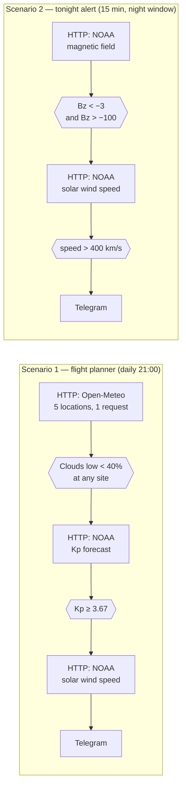

# Aurora Alert — two Make.com scenarios

Event-driven aurora monitoring built on [Make.com](https://make.com). Two scenarios answer two different questions, pull from four public API endpoints, and push plain-language alerts to Telegram.

The engineering point is cost: the system runs on Make's free tier (1,000 operations/month) and uses about **40** of them in normal operation. A naive implementation of the same logic would burn over **8,000**.

---

## The two questions

| | Scenario 1 — flight planner | Scenario 2 — tonight alert |
| --- | --- | --- |
| Question | Is it worth booking a flight? | Is it worth stepping outside right now? |
| Forecast horizon | 2 days | ~1 hour |
| Trigger | daily, 21:00 | every 15 min, 20:00–06:00 only |
| Signal | cloud cover at 5 sites + Kp forecast | IMF Bz + solar wind speed |
| Output | Telegram message with pre-dated flight-search links | Telegram alert with plain-language conditions |
| Normally | always on | enabled on demand |

They cannot be one scenario: their forecast horizons differ by a factor of ~50.

---

## Architecture



Both follow the same shape: fetch, filter, fetch again only if needed, notify.

---

## Why it costs ~40 operations instead of 8,700

Make bills **per executed module**, not per scenario run. Filters are free and stop everything to their right.

That single fact drives the whole design:

1. **Every expensive call sits behind a free check.** On a typical night the chain stops after module 1 — one operation, not three.
2. **Module order is not arbitrary.** The first module always runs and always costs one operation, so the first slot goes to the fetch that most often says *no* and returns the smallest payload.
3. **Time windows beat conditional logic.** A run outside the schedule window costs nothing at all. 96 runs/day become 40 runs/night.
4. **Batch what the API will batch.** Open-Meteo accepts five coordinate pairs in one request and returns an array. Five locations, one operation.

| Variant | Operations/month |
| --- | --- |
| Every 15 min, round the clock, all modules | ~8,700 |
| This architecture, normal operation | ~40 |
| This architecture, including one week of travel | ~320 |

### No iterators — on purpose

The NOAA Kp file holds ~1,400 entries. An Iterator would split it into 1,400 bundles and every downstream module would run 1,400 times. One execution would consume a month and a half of free-tier budget.

Instead the needed element is addressed directly:

```
{{parseNumber(5.data[80].kp)}}
```

---

## Data sources

All public, no authentication, no API keys.

| Source | Endpoint | Used for |
| --- | --- | --- |
| Open-Meteo | `/v1/forecast` | `cloud_cover`, `cloud_cover_low` for 5 Lapland sites |
| NOAA SWPC | `/products/noaa-planetary-k-index-forecast.json` | 3-day Kp forecast |
| NOAA SWPC | `/products/summary/solar-wind-mag-field.json` | `bz_gsm`, `bt` (IMF, from DSCOVR) |
| NOAA SWPC | `/products/summary/solar-wind-speed.json` | `proton_speed` |

Monitored locations: Abisko, Kiruna (SE), Saariselkä, Levi, Rovaniemi (FI).

---

## Setup

1. **Import** a blueprint: Make → *Create a new scenario* → ⋯ menu → *Import Blueprint* → pick a file from `blueprints/`.
2. **Telegram connection.** Create a bot via [@BotFather](https://t.me/botfather), then open the Telegram module and add your own connection. The blueprints ship with no connection attached.
3. **Chat ID.** Replace `YOUR_TELEGRAM_CHAT_ID` in the Telegram module. For a group, add the bot to it, post a message, and read the id from
   `https://api.telegram.org/bot<TOKEN>/getUpdates` — group ids are negative.
4. **Departure airport.** Replace `YOUR_AIRPORT` in the Telegram message of scenario 1 with your own IATA code (5 occurrences, inside the flight-search URLs).
5. **Locations.** Edit the `latitude` / `longitude` lists in the Open-Meteo URL of scenario 1. Order matters: `data[1]` is the first coordinate pair, `data[2]` the second, and so on. Keep the filter conditions and message mappings in sync. The destination codes (KRN, LLA, IVL, KTT, RVN) sit in the message text and must match.
6. **Thresholds.** See `docs/architecture.md` before changing them — several values look wrong but are not.

Notification texts are in Ukrainian. Scenario 2 renders roughly as:

```
🚨🌌 AURORA — GO OUTSIDE!
⏱ Starting in 30–60 minutes.

🚪 Door to the atmosphere: WIDE OPEN
(-12.4 nT — the deeper the minus, the better)
💨 Solar wind: fast
(521 km/s)
🔋 Reserve: medium
(11 nT)
```

The wording is produced by nested `if()` cascades that translate raw instrument readings into something readable at 2 a.m.

---

## What was removed before publishing

The blueprints in this repo are sanitised exports, not raw ones. Removed:

- the Telegram **chat ID** → `YOUR_TELEGRAM_CHAT_ID`
- the Make **connection ID** and its label (`parameters.__IMTCONN__` and `metadata.restore.parameters.__IMTCONN__`)
- cached **API response samples** under `metadata.designer.samples` — these held request timestamps and CDN trace headers
- account identifiers: team ID, scenario IDs, creator name and e-mail
- the **departure airport** in the flight-search links → `YOUR_AIRPORT`, since a home airport plus a public profile narrows down where you live

**No tokens were ever in these files.** Make stores bot tokens and OAuth credentials in the Connection object, which is never part of a blueprint export. Neither scenario sets or reads cookies (`shareCookies: false` throughout).

If you export your own blueprints, check the same four places before committing.

---

## Licence

MIT — see `LICENSE`.
