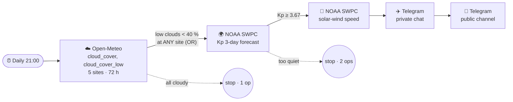

<p align="center">
  
</p>

<p align="center">
  
  
  
  
  
  
</p>

**Two different questions are answered by two Make.com scenarios:**

| | Question | Schedule | Data checked | Output |
|---|---|---|---|---|
| ① | **Soll ich zu Aurora fliegen?** Is it worth booking a trip to Lapland? | daily, 21:00 | cloud forecast for 5 sites (2 days ahead) + Kp forecast + solar wind | Telegram alert with cloud cover per site and **Google Flights deep links** BER → KRN / LLA / IVL / KTT / RVN |
| ② | **Soll ich raus für Aurora?** Should I go outside right now? | every 30 min, 20:00–06:00 | real-time solar wind measured at L1 (≈ 1.5 million km upstream) | "Go outside" alert with 30–60 min lead time, plain-language explanation and camera settings |

No server and no hosted code are needed. Three public APIs, a few filters and Telegram are used.

https://github.com/user-attachments/assets/cd06d5f8-49d8-4858-8489-06d2e0737e6c

<p align="center"><sub>A 64-second walkthrough was filmed in the real Make.com scenarios: canvas, filters, a real alert run and a real quiet run. <a href="assets/aurora-walkthrough.mp4">Download MP4</a></sub></p>

---

## Architecture

<p align="center"></p>

<details>
<summary><b>Same flows as Mermaid (click to expand)</b></summary>




</details>

## Inside Make

| ① Trip planner: scenario canvas + 30-day ops chart | ② Live alarm: canvas + ops chart (peak during the 21–22 Oct storm) |
|---|---|
|  |  |
|  |  |

The effect of the filter design is shown in the operations column: **2 operations** are used on quiet nights, **5** when the alert is sent to both Telegram targets.

## What the alerts look like

<p align="center"></p>

---

## Live run statistics

The figures were taken from the Make execution log on **10 Nov 2026** (via the Make MCP API). The raw data is stored in [`data/`](data/); every chart is rebuilt by [`scripts/make_charts.py`](scripts/make_charts.py).

### ① Trip planner: 32 evenings, 9 trip alerts

<p align="center"></p>
<p align="center"></p>

| Metric | Value |
|---|---|
| Scheduled evening runs (9 Oct – 9 Nov) | **32**, all successful |
| Stopped by clouds at all 5 sites | 5 (16 %) |
| A clear site, but Kp forecast < 3.67 | 18 (56 %) |
| **Trip alert sent** | **9 (28 %)**, in clusters: 9–10, 17–18 and 28–29 Oct, then 4, 6 and 7 Nov |
| Operations used | 80, so **2.5 ops per evening ≈ 75 ops / month** |
| Median run time | 0.9 s (max 3.3 s) |
| Errors | 0 in scheduled runs. In 1 manual test run, `503 Service Unavailable` was returned by an API |

### ② Go-outside alarm: two storm nights at 15-minute resolution

<p align="center"></p>

On **21–22 October**, the solar-wind conditions stayed "open" for hours, so the alarm was triggered **21 times in two evenings**. The same alert was sent again in each 15-minute run. This is the main reason for the cooldown in the [roadmap](#roadmap).

| Metric (94 runs, nights of 20 – 22 Oct) | Value |
|---|---|
| Bz not south enough | 70 |
| Bz south, but wind ≤ 450 km/s | 3 |
| **Alert sent** | **21** |
| Lifetime totals (Make counter) | 486 runs · 564 ops · 0 errors |

---

## The physics behind the filters

<details>
<summary><b>Why these three numbers? (click to expand)</b></summary>

**Kp index (trip planner).** Kp is a planetary 0–9 index of geomagnetic disturbance; it is calculated from 3-hour magnetometer readings worldwide. The higher the index, the further south the auroral oval is spread. A 3-day forecast in 3-hour slots is published by NOAA SWPC, and the slot that matches the target night is read by the scenario. Lapland (~68° N) lies under the oval even at low Kp, so **Kp ≥ 3.67 ("4−")** is set as a deliberately strict bar: a flight is worth booking only for a *strong* display.

**Low clouds decide (trip planner).** Total cloud cover is misleading for aurora: thin high cirrus hardly matters, while everything is blocked by low stratus. Therefore `cloud_cover_low` is checked by the filter, and total cover is shown in the message with low cover in brackets. The five sites are combined with **OR**: one clear site is sufficient, because it can be reached by car.

**Bz and solar-wind speed (live alarm).** The solar wind is measured by spacecraft at the L1 point, about 1.5 million km before it reaches Earth. **Roughly 20–60 minutes of warning** are gained in this way, depending on the wind speed.
- With **Bz < 0** (southward interplanetary magnetic field), a coupling with Earth's field is created, and "the door is opened". The more negative the value, the better. Fill values and sensor glitches are rejected by the lower bound of −100 nT.
- At a **speed above 450 km/s**, more energy is delivered. The speed is graded in the message as normal, fast (> 500) or very fast (> 600).
- **Bt** (total field strength) is shown as "power reserve": with a high Bt, Bz can become even more negative.

**27-day recurrence.** If the wind is faster than 580 km/s, a likely **coronal hole** is flagged in the trip alert. Coronal holes rotate with the Sun (≈ 27 days), so a repeat date is predicted in the alert with `addDays(now; 27)`.
</details>

## Engineering notes

The reason for each value (including values that look like mistakes but are not) is documented in **[docs/architecture.md](docs/architecture.md)**.


- **Filter-first ordering = cost control.** In Make, one operation is charged for every executed module. Because the cheapest check that fails most often (clouds, or Bz) is placed first, **72 % of trip-planner evenings are stopped after 1–2 operations**. Telegram is run only on the 28 % of evenings that matter.
- **OR filter across sites.** Five OR groups are set in the "Clouds low" filter, one per site. The filter is passed if any single site is clear.
- **Index arithmetic.** 72 hourly values are returned by Open-Meteo (3 days × 24 h, local time zone). Arrays in Make are **1-based**, so `hourly.cloud_cover_low[71]` refers to 22:00 local time on day 3. This matches "+2 days, 22:00" in the message.
- **Defensive parsing.** NOAA values can be delivered as strings, so `parseNumber()` is used in every comparison.
- **Kp slot without a date lookup.** 81 three-hour slots are contained in the NOAA forecast file: 7 days back and 3 days ahead, starting at 00:00 UTC. At run time (20:00 UTC), slot `data[80]` refers to **21:00 UTC two days ahead = 22:00 CET**, the same night that is targeted by the cloud check (verified against the live file on 10 Nov 2026).
- **Inline decision logic.** The plain-language grades ("doors wide open", "very fast wind", "big power reserve") are built with nested `if()` expressions inside the Telegram template. No extra modules and no extra operations are needed.
- **Deep links instead of a flight API.** A ready-made search for each airport is opened by Google Flights `?q=` URLs with computed dates (`addDays(now; 2)` to `addDays(now; 5)`). No costs are incurred, and no API key is needed.
- **Free-tier budget.** About 75 ops/month are used by the trip planner. At least 1 op per run is used by the live alarm: 21 runs/night × 30 ≈ **630+ ops/month** at a 30-minute interval (twice as many at 15 min). On 3 Nov, the interval was changed from 15 to 30 min, so this number was halved.

## Roadmap

- [ ] **Cooldown / de-duplication** for the live alarm: the time of the last alert is stored in a Make **Data Store**, and new alerts are skipped for 90 min (see the problem of 21 alerts in 2 nights above).
- [ ] **Mid-latitude mode.** The live thresholds are tuned for sites under the auroral oval (see [design notes](docs/architecture.md)). For observation from Berlin (~52.5° N), Kp 6–7 is typically needed, so false alarms there would be reduced by a second profile with Bz ≤ −5 nT and a Kp-nowcast check.
- [ ] **Local cloud check** for the live alarm (Open-Meteo for the observer's position) before "go outside" is sent.
- [ ] **Error route** on the HTTP modules (`Resume`/`Ignore` and a quiet Telegram note) for occasional NOAA `503` errors.
- [ ] The Kp slot is to be selected by `time_tag` (e.g. `map()` + `get()`) instead of the fixed position `[80]`, so that the night cannot be shifted silently by a change in the NOAA file layout.
- [ ] One shared message template is to be created via **Set variable**, instead of duplicating the text in both Telegram modules.

## Repository layout

```
docs/         design notes: why every threshold and index is what it is
assets/       banner, architecture diagram, charts, message layouts (SVG), walkthrough video (MP4 + cover), screenshots/ from Make
blueprints/   sanitized Make blueprints, importable via Scenario → ⋯ → Import Blueprint
data/         execution logs exported from Make (CSV)
scripts/      build_live_csv.py · make_charts.py · make_diagram.py · make_telegram_mock.py · make_video.py · make_video_v2.py
```

### Set-up

1. In Make, a new scenario is created, and a file from `blueprints/` is imported via **⋯ → Import Blueprint**.
2. A Telegram bot is created with [@BotFather](https://t.me/BotFather), the Telegram connection is added, and `YOUR_PRIVATE_CHAT_ID` and `@YOUR_PUBLIC_CHANNEL` are replaced. For departures from an airport other than Berlin, `BER` in the flight links is replaced with the IATA code of that airport.
3. The coordinates in the Open-Meteo URL are replaced with the observation sites, and the schedule is set.

The visuals are rebuilt with: `pip install matplotlib && python scripts/make_charts.py && python scripts/make_diagram.py && python scripts/make_telegram_mock.py`

---

<sub>Data sources: <a href="https://open-meteo.com/">Open-Meteo</a> (CC BY 4.0) · <a href="https://www.swpc.noaa.gov/">NOAA Space Weather Prediction Center</a> (public domain).<br>Author: <b>Dariia Sichynska</b>. The scenario edits under her account are shown in the Make history screenshots above.</sub>
